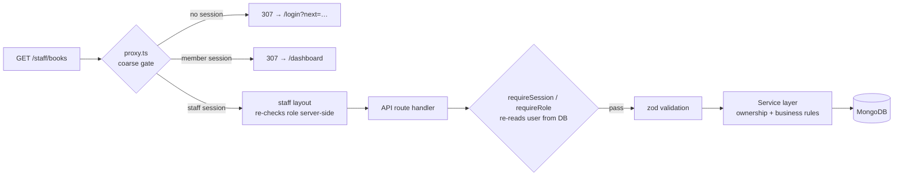
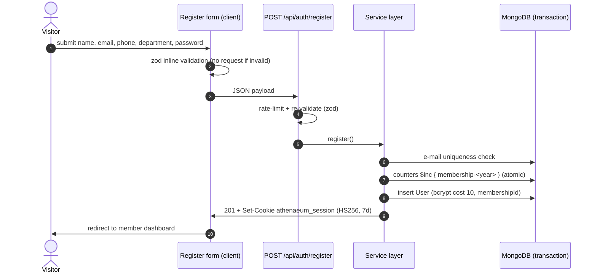
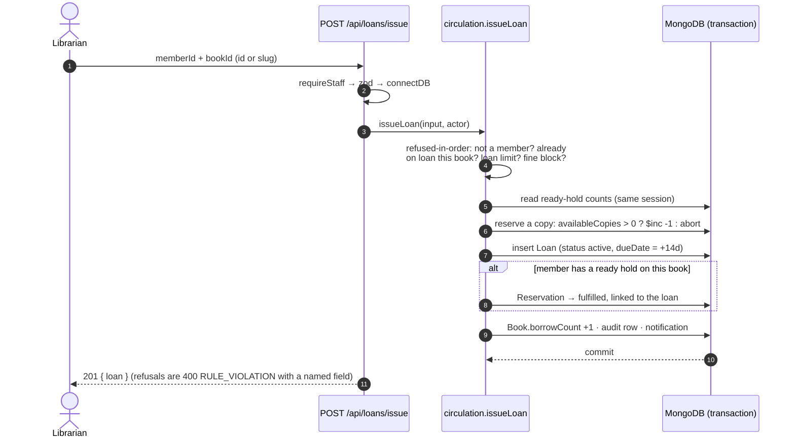
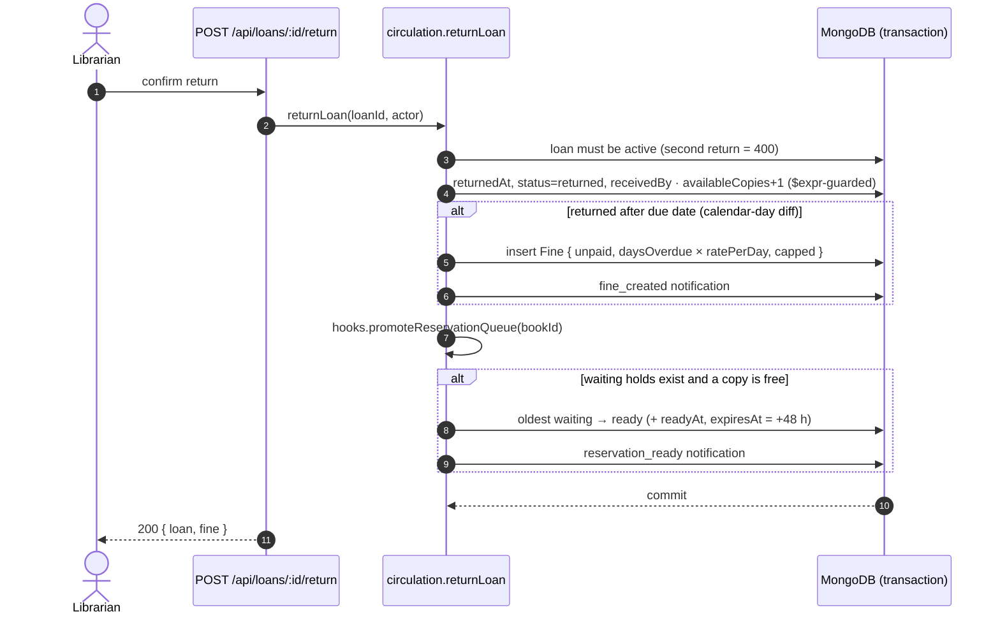
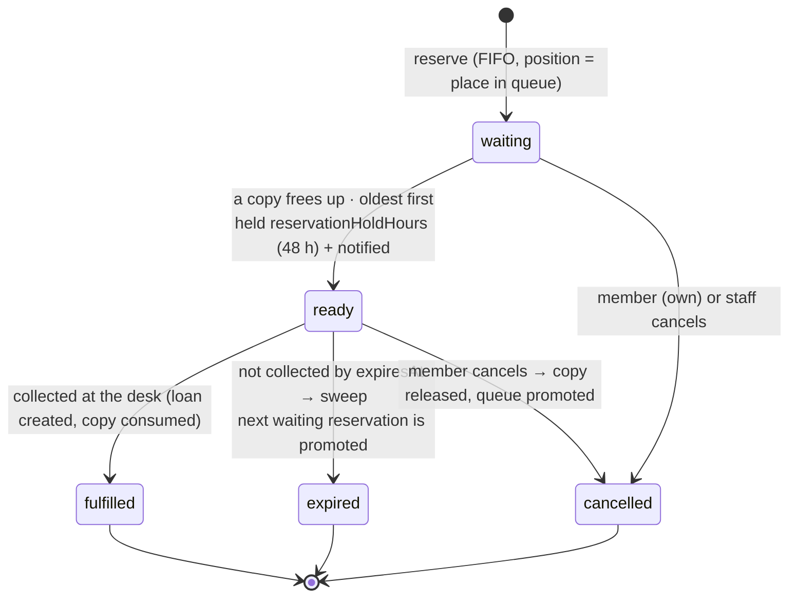
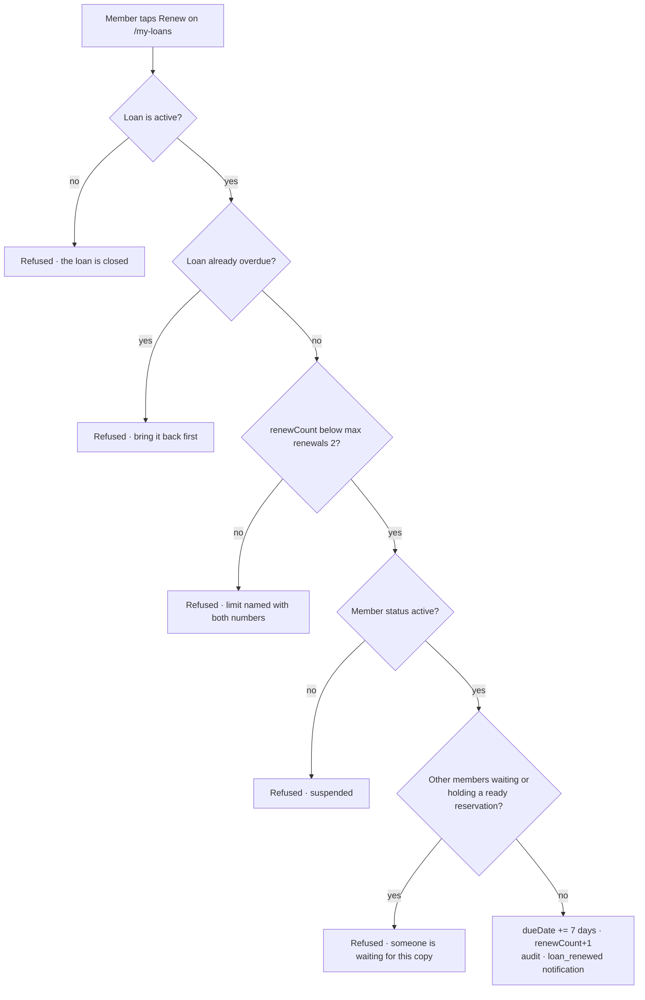
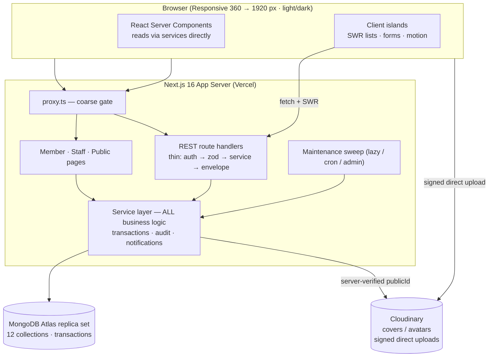
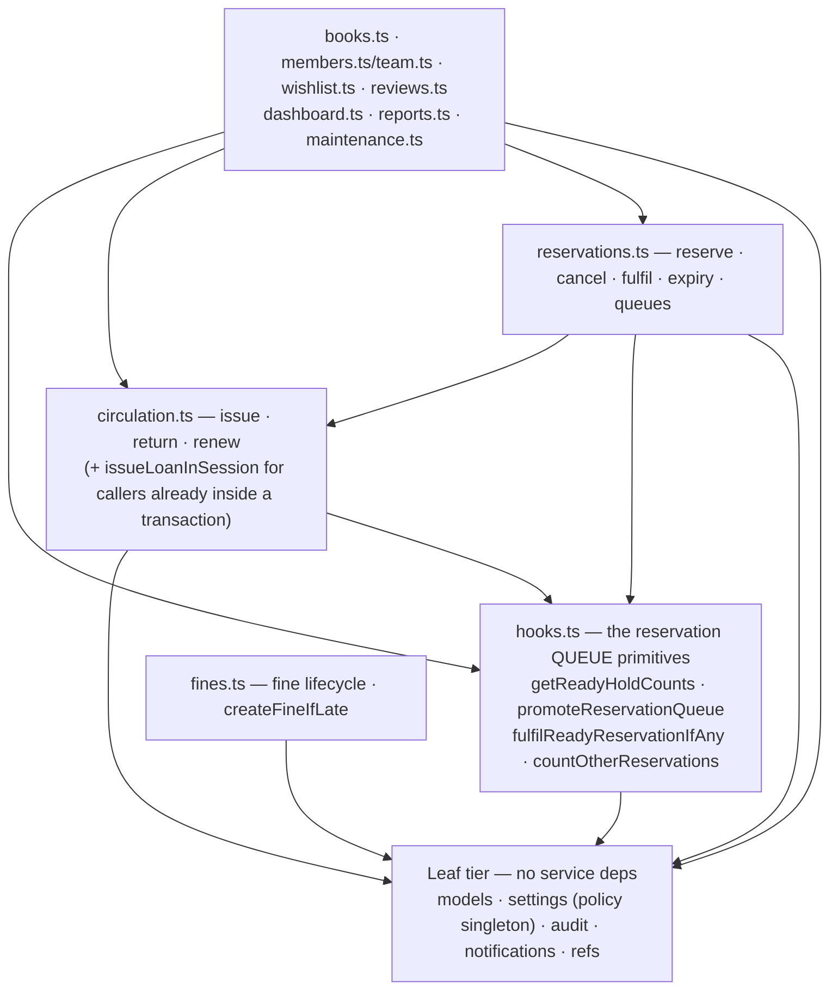
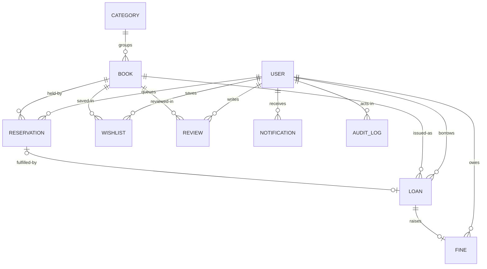
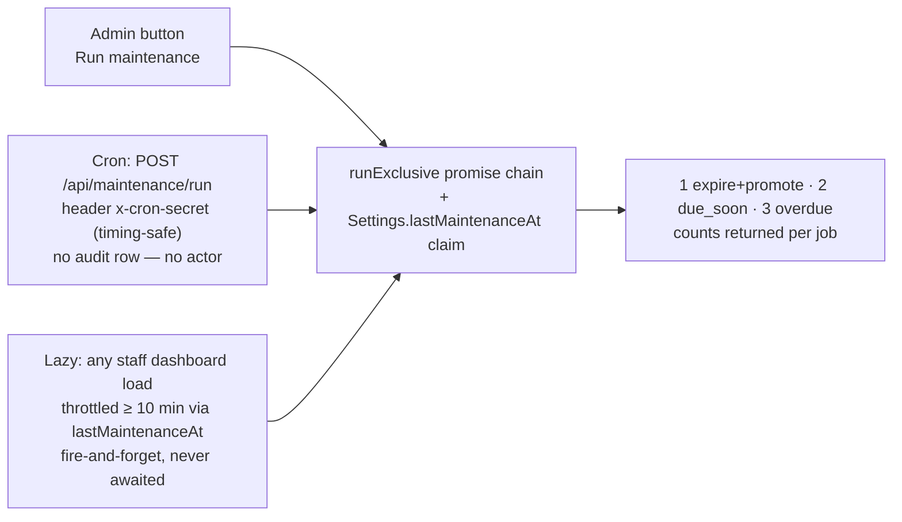

# Athenaeum — University Library Management System


**Athenaeum** is a full-stack, production-grade Web Library Management System for a university or college library. It digitises the complete circulation lifecycle — cataloguing books, registering members, issuing / returning / renewing loans, reservations (holds), overdue tracking, fines, in-app notifications, dashboards, six staff reports with CSV export, and an immutable audit trail — behind three role-based experiences (Member, Librarian, Admin).

The interface is a warm, editorial, "parchment & ink" reading room: parchment surfaces, deep forest primary, a terracotta accent, serif display type (Fraunces), subtle purposeful motion, full dark mode, and WCAG 2.2 AA contrast in both themes.

> The library display name is configurable by the administrator from **Staff → Settings**, so "Athenaeum" is the product's default identity, not a hard-coded one.

---

## Table of Contents

1. [About the System](#1-about-the-system)
2. [Feature Catalog](#2-feature-catalog)
3. [Roles & Access Model](#3-roles--access-model)
4. [Professional Use Cases](#4-professional-use-cases)
5. [System Architecture](#5-system-architecture)
6. [Authentication & Security](#6-authentication--security)
7. [Data Model](#7-data-model)
8. [Business Rules](#8-business-rules)
9. [API Reference](#9-api-reference)
10. [Notifications](#10-notifications)
11. [Background Maintenance Job](#11-background-maintenance-job)
12. [Reports, CSV Export & Audit Trail](#12-reports-csv-export--audit-trail)
13. [Design System](#13-design-system)
14. [Project Structure](#14-project-structure)
15. [Getting Started](#15-getting-started)
16. [Environment Variables](#16-environment-variables)
17. [NPM Scripts](#17-npm-scripts)
18. [Quality Bar & Testing](#18-quality-bar--testing)
19. [Deployment](#19-deployment)
20. [Out of Scope](#20-out-of-scope)

---

## 1. About the System

| Aspect | Detail |
|---|---|
| **Domain** | Academic library circulation: members borrow physical books issued at a staffed circulation desk. |
| **Users** | Members (students/staff of the institution), Librarians, an Administrator. |
| **Core promise** | Every number a user sees (availability, due dates, fines, queue positions, dashboards, reports) is computed **in the database at request time** from the live collections — never counted in the browser, never hardcoded policy. |
| **Consistency** | All multi-document mutations (issue, return, reserve-promote, rating recompute) run inside **MongoDB transactions**, so `availableCopies` can never go negative or exceed `totalCopies`. |
| **Accountability** | Every important action writes a row to an append-only **audit log** and, where relevant, a member **notification**. |
| **Stack** | Next.js 16 App Router + React 19 Server Components, TypeScript strict, MongoDB Atlas (replica set) via Mongoose 8, Cloudinary signed uploads, Tailwind CSS v4 design tokens, accessible shadcn/ui primitives, recharts dashboards. |

### Why this shape

This is a **circulation system with a web face**, not a generic CRUD app. Two design consequences follow:

- **The desk is authoritative.** Only staff issue loans; a member browsing the catalog is told to visit the desk (or joins a hold queue when no copy is free). This matches how physical libraries actually work and keeps policy enforcement in one place.
- **Policy is data, not code.** Loan period (14 days), active-loan limit (5), renewal rules (2 × +7 days), fine rate ($5/day, capped at $250), fine blocking threshold ($100), reservation hold window (48 h) and every override of them live in a **Settings singleton** and are read fresh at request time by the services that need them.

---

## 2. Feature Catalog

| # | Feature | What it delivers |
|---|---|---|
| 1 | **Authentication & accounts** | Member self-registration, login/logout, 7-day httpOnly JWT session, bcrypt-hashed passwords, generated unique membership IDs (`LIB-2026-0042`), suspension with reason, staff accounts created by the admin. |
| 2 | **Profile** | Edit name / phone / department, change password (current password required), Cloudinary avatar with live preview and removal; email, membership ID, role and member-since are read-only. |
| 3 | **Categories** | Staff CRUD with auto-slugs, 42-icon curated Lucide whitelist, six accent colours, live book counts; deletion is blocked while any book references the category. |
| 4 | **Book cataloguing (staff)** | Full bibliographic records (title, multiple authors, ISBN-10/13 with checksum validation, publisher, edition, year, language, category, tags, description, page count, shelf location), Cloudinary cover upload with generated typographic fallback, system-managed copy arithmetic, archive/restore, bulk archive, hard delete only for never-loaned books. |
| 5 | **Public catalog & book detail** | Grid/list browsing with debounced URL-synced search across title/authors/ISBN/tags, category / language / availability / year-range filters, six sorts, pagination, facets; detail page with cover, metadata, availability badge, queue length, related books, reviews, Reserve/Wishlist/Share. |
| 6 | **Members management (staff)** | Searchable register, member detail with KPI tiles and real loan/fine/reservation tab data, suspend (reason required) / activate, temporary-password reset. |
| 7 | **Team management (admin)** | Create librarian/administrator accounts with a generated temporary password, rename, enable/disable; roles are deliberately not promotable post-creation. |
| 8 | **Circulation (issue / return / renew)** | Two-pane desk with member + book search and a policy checklist "issue ticket"; return with automatic fine computation and reservation promotion; renew by member or staff honouring all limits. |
| 9 | **Reservations (holds)** | FIFO queue per book with no-copy rule (one reservable only when nothing is available to that reader), membership cap, 48 h ready-hold window, member cancel, staff fulfil (issues + closes in one transaction), expiry + automatic re-promotion. |
| 10 | **Fines** | Auto-raised at late return (`days overdue × rate`, capped), staff collect (exact amount, payment method) or waive (reason required), blocking threshold enforced at issue time, member and staff fine pages with real outstanding totals. |
| 11 | **Wishlist & reviews** | Optimistic heart toggles; idempotent add/remove; rating + comment reviews restricted to members who have borrowed the title, one per member per book, live aggregates on the book; staff moderation. |
| 12 | **In-app notifications** | Bell with unread badge (whole-inbox count), dropdown, full inbox, mark read / mark all; 14 event types with server-resolved tones. |
| 13 | **Dashboards** | Member: greeting, active loans with countdown rings, ready-holds banner, fine balance, "currently reading" scroller, recommendations from reading history. Staff: 7 KPI tiles with count-up, loans-per-day area chart, category donut, top-5 bars, recent audit activity feed, low-stock list, due-today list. |
| 14 | **Reports** | Six staff reports (borrowing, overdue, popular, member activity, fines, inventory) with date/category filters, in-database sorting + pagination, summaries that always equal the sum of their rows, CSV export. |
| 15 | **Settings (admin)** | Library identity and every policy number, validated and audited with before/after diffs; effective for the next request across circulation, reservations, fines, reports. |
| 16 | **Audit log (admin)** | Immutable, filterable register of every important action with actor, entity, human summary and expandable metadata. |
| 17 | **Maintenance** | Expiration of stale holds, queue promotion, due-soon and overdue notices — idempotent per loan per day; three triggers detailed in §11. |
| 18 | **Landing page** | Fully data-driven marketing home: hero with live search, real stats band, category explorer, new-arrivals shelf, how-it-works, member-benefits CTA. |
| 19 | **Platform quality** | Responsive 360 → 1920 px, light/dark/system themes, keyboard accessible, reduced-motion respected, loading/empty/error/404 states everywhere, zero console errors as the bar. |

---

## 3. Roles & Access Model

### 3.1 Role capabilities

| Capability | Member | Librarian | Admin |
|---|:---:|:---:|:---:|
| Register / own profile / own password | ✅ | — | ✅ (own) |
| Browse catalog, wishlist, reviews | ✅ | ✅ | ✅ |
| Reserve books, cancel own holds, renew own loans | ✅ | — | — |
| Issue / return / renew on behalf of anyone | — | ✅ | ✅ |
| Manage books, categories, reservations fines, members | — | ✅ | ✅ |
| Collect / waive fines | — | ✅ | ✅ |
| View dashboards & all six reports + CSV | member-dash | ✅ | ✅ |
| Team management (create/disable staff) | — | — | ✅ |
| Library settings & policies | — | — | ✅ |
| Audit log & maintenance run | — | — | ✅ (cron via secret too) |

### 3.2 Enforcement layers

Access control is **defence in depth** — a coarse gate for UX, real enforcement for security:



- `src/proxy.ts` (Next.js 16's renamed `middleware` convention) only redirects: anonymous users off protected routes, non-staff off `/staff/*`, signed-in users away from `/login` / `/register` to their role home.
- **Every** route handler independently calls `requireSession()` / `requireRole()` / `requireAdmin()` and re-loads the user record from the database — the token alone is never trusted for privileged actions (a suspended account is caught here even with a valid JWT).
- Ownership is **always derived from the session** (`/api/loans/mine`, `/api/wishlist`, notifications). A client-supplied member id is accepted only where a *staff* role is required and explicitly role-checked.
- A suspended member can sign in and read (their loans, fines and history are exactly what they need), but cannot reserve, renew, publish reviews, or be issued books.

---

## 4. Professional Use Cases

Each use case below states its actor, preconditions, main flow, postconditions and — where the flow has interesting arbitration — a diagram.

### UC-1 · Join the library and reach the catalog *(Member)*

**Preconditions** — visitor has an email address; seed or desk-sourced data exists.
**Flow**
1. Visitor opens the marketing landing page (live counts from the database).
2. Chooses **Register**, submits name / email / phone / department / password (strength metered client-side and validated again server-side with zod).
3. Server hashes the password with bcrypt (cost 10), allocates the next membership ID `LIB-<year>-NNNN` from an atomic counter collection, creates the user, signs a 7-day session cookie (httpOnly · SameSite=Lax · Secure in production), and signs the request in.
4. The member lands in the member console: dashboard shows an honest empty state — *"Borrow something from the catalog and it will appear here."*



**Postconditions** — a `user.create` audit row exists; the member can sign in on any device for 7 days.

---

### UC-2 · Borrow a book that is on the shelf *(Librarian at the desk, Member at the desk)*

The system models physical circulation truthfully: **issuing is a desk action**. Availability is *effective* availability — a copy promised to a ready hold is not borrowable to anyone else.

**Preconditions** — member's status is `active`; the borrower's unpaid fines total ≤ $100; the book is `active` with at least one copy that is neither on loan nor held for somebody else; the member has < 5 active loans and holds no copy of this book already.

**Flow**
1. Librarian opens **Circulation Desk**, searches the member (name / email / membership ID — active members sort first, up to 8 results) and the book (title / ISBN; archived books are never offered). A fail-safe deep link (`?memberId=…`) arrives with the member preselected.
2. Selecting both reveals the **issue ticket**: a live checklist — member active ✓, copies available ✓, within loan limit ✓, unpaid fines shown as *unknown* (the server remains the authority).
3. **Issue book** → the request runs the six business checks server-side (the checklist is only a preview) inside one transaction:
   - create the loan with `dueDate = today + loanPeriodDays (14 d)`;
   - decrement `availableCopies`, increment `borrowCount`;
   - **if the member held a *ready* reservation on this book, the hold is fulfilled and consumed** instead of a shelf copy;
   - write the `loan.issue` audit row and the member's `loan_issued` notification.
4. The desk toast confirms; the member's dashboard immediately shows the book on the "Currently reading" shelf with a countdown ring to the due date.



**Refusals are actionable sentences**, e.g. *“shumail already has 5 books on loan. The limit is 5.”* — the check order is specific-before-general, so the message names the reason a librarian can fix.

**Postconditions** — the loan is visible in the desk's Active table, on the member's **My Loans**, and on the dashboard; the catalog availability badge drops by one.

---

### UC-3 · Return a book, with fine & queue automation *(Librarian)*

**Preconditions** — an `active` loan exists; nobody has modified it outside the app.
**Flow**
1. Librarian finds the loan in the desk's tables (or via search) and confirms **Return**. A dialog previews the *potential* fine for display only.
2. The server — not the dialog — decides, in one transaction:
   - set `returnedAt`, `status = returned`, record `receivedBy`;
   - restore the copy (`availableCopies + 1`), with an `$expr` guard so the restoration can never push `availableCopies` above `totalCopies`;
   - **if late**, raise a fine: `daysOverdue × finePerDay (capped)`, where *days overdue* counts **calendar days** (due 23:00 yesterday, returned 01:00 today ⇒ 1 day);
   - **promote the reservation queue**: if copies are free and a `waiting` hold exists, the oldest becomes `ready` with a fresh 48 h window and the member is notified;
   - write the `loan.return` audit row and the member's `loan_returned` notification.
3. The response carries the loan plus `fine: null | { … }`; a second return attempt is refused with a named state error.



**Postconditions** — the loan moves to the Returned tab / member History; any fine appears on the member's **Fines** page and the staff fines register; a queued member may now be standing.

---

### UC-4 · Reserve a fully-out book and collect the hold *(Member → Desk)*

**Preconditions** — the member is `active`, has < 3 open reservations, holds no copy of the book, and *effective availability for them is zero* (reserving a visible shelf copy is refused — *"Copies are available — visit the desk"*).
**Lifecycle**



Rules encoded by the database, not by check-then-insert races:

- **one open reservation per member per book** — partial unique index on `{ book, member }` across `waiting`/`ready`;
- `queuePosition` is non-null **only** while `waiting`; a ready hold counts in the FIFO order (the person behind a ready head is #2) but never gets a number, so two members can never both be "#1";
- expiry is idempotent work of the maintenance sweep; an automatic expiry writes **no** audit row (the clock is not an actor) — the state change plus the notification is the record;
- reservations whose book was removed from the catalog still render with a "No longer in the catalog" placeholder and no link.

Members manage everything on **Reservations** (`/reservations`): Ready (with countdown), Waiting (with live positions), Past (capped with its total). Staff see the full register, can fulfil a ready hold (creating the loan directly) or cancel.

---

### UC-5 · Renew a loan *(Member self-service or Librarian)*

**Decision flow** — the button always reports *why* a renewal is refused:



- Renewal is the **only member-performable loan mutation** — the ownership check lives in the service, so a member renewing another member's loan is 403, not a silent error.
- As with all refusals, the exact message is the server's, shown verbatim; the UI previews but never decides.

---

### UC-6 · Self-service reading life *(Member)*

Beyond loans, a member runs their whole reading life without staff:

- **Dashboard** — greeting by name and date; the three KPIs that matter (active loans, ready holds, outstanding fines); the "Currently reading" scroller with overdue/due-soon colouring; a "Ready for pickup" banner; "Recommended for you" built from the categories of past loans (excluding held titles, falling back to popular); a wishlist preview.
- **My Loans** — tabs for Active / Due soon / Overdue / Returned with real rows, countdown rings (real text, not decoration — it is announced once via `role="status"`), optimistic renewal with rollback on failure, and links to the catalog records.
- **Wishlist** — one-tap save/unsave with spring-pop animation, optimistic UI, idempotent both ways; rendered in the dashboard preview.
- **Reviews** — rate 1–5 + optional comment, only for borrowed titles; the rating summary (average to one decimal, real count, five-bucket star distribution) is recomputed in the same transaction as the write, so a card can never say "No ratings" above a page listing four reviews.
- **Fines** — outstanding total plus history (paid / waived stay visible); notices when a fine appears.
- **Notifications** — full inbox with filter, unread badge, mark read / all read.

---

### UC-7 · Run the desk day-to-day *(Librarian)*

A librarian's console is organised around the counters actually worked each day:

- **Staff dashboard** — KPI tiles (titles, copies, members, active loans, overdue, ready holds, unpaid fines); 30-day loans-per-day chart; loans-by-category donut; top-5 borrowed bars; recent activity from the audit log; low-stock list (≤ 1 available copy); due-today list. Each figure is a server aggregation, never a browser count.
- **Catalogue and curate** — add/edit books with a two-column form and sticky action footer, cover upload via signed direct-to-Cloudinary upload, live `BookCover` preview, ISBN live checksum tick; archive/restore and bulk archive; act on data with a toolbar whose search/filters/sort/page are all URL-synced.
- **The desk** — the issue ticket, the four loan tabs with one-click return/renew, and queue promotion handled by UC-3. The desk overflows at no width — its layout was verified at 360 px.
- **Reservations register** — Ready (fulfil or let expire) / Waiting / History with pagination, per-book queue views.
- **Fines desk** — collect (exact amount, method: cash/card/other, optional note) or waive (reason required, 3–500 chars); totals computed across all fines, not just the visible page.
- **Members** — the register, suspension with a stored, notified reason (activation clears it so no stale banner survives), temporary-password reveal-once.

---

### UC-8 · Govern the library *(Admin)*

The administrator's job is policy, people and accountability:

- **Settings** — every policy number (identity, circulation, fines, reservations, currency), validated numeric ranges, audited with `before`/`after` in the log's metadata. A change takes effect for the **next request** in every consumer (circulation, reservations, fines, overdue reports) — the point of policy-as-data.
- **Team** — create librarian/administrator accounts with generated temporary passwords (generated in-browser so a mistyped email is caught before the account exists; the server derives its own from the same single implementation), disable accounts; roles are immutable post-creation and the system will not let the last active admin lock themselves out.
- **Reports & CSV** — six reports with date/category filters and one-export-matches-the-screen CSV (UTF-8 BOM, RFC 4180 escaping, CSV-injection defusal for formula attacks, filename `athenaeum-<type>-<date>.csv`).
- **Audit trail** — the filterable register of *who did what to which entity, when*; excluded items and staff removals are as visible as issues and returns. Deleted actors read "Unknown user · removed account" without blanking history.
- **Maintenance** — one click (see §11 for the three triggers and the safeguards).

---

## 5. System Architecture

### 5.1 System context



### 5.2 Request lifecycle & layer contract

The app observes a strict three-line contract, which is what keeps it auditable and testable:

> **UI never talks to Mongoose. Route handlers never contain business logic. Services never read `Request`/`Response`.**

- **Reads happen in Server Components** through services directly (no HTTP hop of their own API in the server, no client waterfall on first paint).
- **Interactive lists** (catalog browser, staff tables) hydrate via small client components using SWR against the REST API, keyed on the URL filters.
- **Every response** uses one envelope:

```
{ success: true,  data, meta? }
{ success: false, error: { code, message, fields? } }
```

with the standard error codes `UNAUTHENTICATED(401) · FORBIDDEN(403) · NOT_FOUND(404) · RULE_VIOLATION(400) · VALIDATION(422) · CONFLICT(409) · RATE_LIMITED(429) · INTERNAL(500)`. Policy refusals are `RULE_VIOLATION` **with a field** where one applies, so forms can put the sentence beside the input.

### 5.3 Service layer (the only place business logic lives)



Engineering properties that matter in daily operation:

- **Flywheel guarantees under concurrency.** A copy is taken with a single conditional update (`availableCopies > 0` + `$inc`), so two simultaneous issues for the last copy produce exactly one winner; restoration is `$expr`-guarded so counts can never drift outside `[0, totalCopies]`.
- **No nested transactions.** MongoDB has none, so `issueLoanInSession` is the same issue minus the transaction wrapper — the boundary lives in exactly one place per entry point. Every hook callable from inside a transaction takes the open session, so no read/write can fall outside the caller's snapshot.
- **Idempotency by design.** Notification dedupe keys are read *before* insert (a duplicate-key error caught after the fact would leave the whole transaction poisoned — Mongo aborts the unit of work on any write error); wishlist adds and notification mark-reads are idempotent keys/indexes rather than try/catch hopes.
- **Policy is read, never written, inside transactions.** The settings singleton is cached 30 s and read at request time by every consumer; no transaction writes it.

### 5.4 Where data lives

| Data | Store |
|---|---|
| All domain records (12 collections) | MongoDB Atlas (replica set — required by transactions) |
| Book covers, avatars | Cloudinary folders `athenaeum/covers`, `athenaeum/avatars`; Mongo stores `{ url, publicId }` only |
| Sessions | Stateless signed JWT (HS256, 7 d) in the `athenaeum_session` httpOnly cookie |
| Theme preference | `next-themes` (localStorage) |
| Public landing stats | `/api/public/stats`, cached 60 s |
| Nothing else | No Redis, no message queue, no external cache |

---

## 6. Authentication & Security

| Control | Implementation |
|---|---|
| **Password storage** | bcrypt, cost 10; `passwordHash` is `select: false` and is projected out of every query response. |
| **Sessions** | jose HS256 JWT `{ sub, role, name }`, 7-day expiry, httpOnly + SameSite=Lax + Secure (prod) cookie; the server re-reads the user from the DB on every guarded call. |
| **Login rate limiting** | Sliding window, 5 attempts / 10 min per IP+email, memory-based, reset on success. |
| **Route gating** | Coarse `proxy.ts` redirects + per-route `requireSession` / `requireRole` / `requireAdmin` / `requireActiveMember` re-reading the DB record. |
| **Ownership** | Invariant: derived exclusively from the session user id. `/mine` endpoints accept no member id at all — the URL cannot be edited to read someone else's data. |
| **Suspension semantics** | Suspended users may sign in and read; reserving, renewing, review publishing and being issued are refused with clear messages. |
| **Uploads** | Server-signed Cloudinary params (`signature, timestamp, apiKey, cloudName, folder, allowedFormats`). `covers` are staff-only; avatars member-scoped. The **avatar URL is derived server-side from `publicId`** — client-supplied URLs are ignored, so one user cannot plant content another user loads. Secrets never reach the client (`cloudinary-shared` vs. server-only `cloudinary.ts` module split makes the wrong import a *build* failure). |
| **Input validation** | One set of zod schemas (client forms + server handlers). Empty PATCH bodies and inverted date ranges are explicit 422s, never silent no-ops. |
| **Cron trigger** | `POST /api/maintenance/run` accepts `x-cron-secret`, compared with `timingSafeEqual`; an **unset** secret closes the cron path. The role check runs before the header is considered. |
| **Error hygiene** | Handler funnel logs the unexpected server-side and returns a generic message client-side; field errors map to inputs; "deleted" and "not yours" are intentionally indistinguishable on owner-scoped endpoints. |
| **Deleted-data integrity** | Loans, fines and audit rows are never deleted by the app; books with loan history are archived, never hard-deleted. Readers render honest placeholders when a referenced record is gone. |

---

## 7. Data Model

### 7.1 Entity–relationship overview



### 7.2 Collections

**`users`** — members and staff in one collection, distinguished by `role`.

| Field | Notes |
|---|---|
| `name, email` | email lowercased, **unique index**; validation 2–80 / standard e-mail. |
| `passwordHash` | bcrypt cost 10, `select: false`. |
| `role` | `admin | librarian | member` (indexed). |
| `membershipId` | `LIB-YYYY-NNNN`, generated via the atomic `counters` sequence, **unique sparse index**; the field is absent (not `null`) on staff rows so a stored `null` can never exhaust the index. |
| `phone, department` | optional display fields. |
| `avatar` | `{ url, publicId }` Cloudinary; URL server-derived. |
| `status` | `active | suspended` (indexed) + `suspendedReason` (why, stored, audited, notified). |
| `lastLoginAt` | set on successful sign-in. |

**`counters`** — `{ _id: "membership-2026", seq }`; atomic `$inc` per year is what makes concurrent registrations produce gap-free unique IDs.

**`categories`** — `name` (unique), `slug` (unique, auto-reslug on rename), `description`, `icon` (validated against a curated 42-name Lucide whitelist, so a stored icon always resolves), `color` (one of six accent tokens: `forest, terracotta, ocean, plum, ochre, slate`). Delete is refused while *any* book — archived included — references it.

**`books`**

| Field | Notes |
|---|---|
| `title` (2–200) · `authors[]` · `tags[]` ≤ … | **weighted text index**: title ×5, isbn ×4, authors ×3, tags ×2 — powers desk and catalog search. |
| `slug` | unique, on detail links. |
| `isbn` | normalised (digits/X), checksum-validated (real ISBN-10/13 mod-11), **unique sparse index**; absent key if unset — never stored `null`. |
| `publisher, edition, publishedYear, language, pageCount, shelfLocation, description` | bibliographic metadata; language indexed. |
| `category` | required ref (indexed). |
| `cover` | `{ url, publicId }`, optional; generated typographic fallback otherwise. |
| `totalCopies` (≥1) · `availableCopies` (≥0, ≤ total) | `availableCopies` is **system-managed** (circulation + copy edits only). |
| `status` | `active | archived` (archived = hidden, retained for history). |
| `ratingAvg, ratingCount` | denormalised aggregates, recomputed in the transaction with each review write. |
| `borrowCount` | incremented at issue; powers "popular". |
| `addedBy` | creating staff member. |

Compound index `{ status, category, createdAt }`; every list sort ends in a unique `_id` tiebreaker so pagination is stable to the millisecond.

**`loans`** — `book, member (indexed refs) · issuedBy · issuedAt · dueDate (idx) · returnedAt · receivedBy · renewCount · status active|returned (idx) · fineAmount · notes`. Compound `{ member, status }`, `{ book, status }`; **partial unique index on `{ book, member }` where `status = 'active'`** — the "no two active loans of one book" rule is a database guarantee, not a race-prone check. *Overdue is never stored; it is derived* (`active ∧ dueDate < today`).

**`fines`** — `loan (unique ref) · member · book · daysOverdue · ratePerDay · amount · status unpaid|paid|waived (idx) · paidAt · collectedBy · paymentMethod cash|card|other · waivedBy · reason · note`. A fine is the priced snapshot of its loan's late return.

**`reservations`** — `book · member · status waiting|ready|fulfilled|cancelled|expired (idx) · readyAt · expiresAt · fulfilledLoan · cancelledBy`. Partial unique index `{ book, member }` across `waiting`/`ready`; queue order = `createdAt` asc among `waiting`.

**`wishlists`** — `{ member, book }` pairs; **unique compound index makes add/remove idempotent** (a double-click or retried POST finds the existing row instead of conflicting).

**`reviews`** — `{ book, member (indexed), rating 1–5, comment ≤1000 or null }`; unique compound `{ book, member }` expresses one-review-per-member-per-book at the database level. `comment` is stored `null`, never `""`, so one representation of "rated it, wrote nothing".

**`notifications`** — `user (idx) · type (14 enum values, §10) · title · message · link? · readAt · tone info|success|warning|danger · dedupeKey (unique sparse)`; index `{ user, readAt, createdAt: -1 }` powers the inbox and the bell count.

**`auditlogs`** — `actor · action ("loan.issue") · entityType · entityId · summary (human one-liner) · meta`; indexes on `createdAt: -1`, `actor`, `action`; **append-only — never updated, never deleted**.

**`settings`** — a singleton document (`key: "global"`): `libraryName "Athenaeum" · contactEmail · loanPeriodDays 14 · maxActiveLoans 5 · maxRenewals 2 · renewalExtensionDays 7 · finePerDay 5 · maxFinePerLoan 250 · fineBlockThreshold 100 · reservationHoldHours 48 · maxReservationsPerMember 3 · currencyCode USD · currencySymbol $ · lastMaintenanceAt(dt)` — the maintenance throttle. Read via a 30-second cache; every consumer reads it fresh at request time.

---

## 8. Business Rules

All numbers below come from the Settings singleton; they are the defaults, not constants.

### 8.1 Circulation

**R1 · Issue** — all must hold (each refusal is a typed error naming the rule and, where useful, the form field):
1. Member exists, `role = member`, `status = active`.
2. Book `active` and `availableCopies > 0` **after subtracting copies reserved as ready for other members** (the member's own ready hold is used instead).
3. Member's active loans `< maxActiveLoans (5)`.
4. Member holds no other active loan of the same book (database index as backstop).
5. Member's unpaid fines total `≤ fineBlockThreshold (100)`.
6. A member with a **ready** reservation on the book collects it via issue; the hold is fulfilled and consumed in the same transaction.
   Effect: loan created (`dueDate = today + loanPeriodDays`), `availableCopies − 1`, `borrowCount + 1`, audit row, notification.

**R2 · Return** — loan must be `active`; sets `returnedAt / status / receivedBy`, restores the copy under an `$expr` guard, computes `daysOverdue` on **calendar days** and, if late, creates a fine `daysOverdue × finePerDay` **capped at maxFinePerLoan**, raises notifications, and promotes the reservation queue.

**R3 · Renew** — loan `active`, not overdue, `renewCount < maxRenewals (2)`, member `active`, and **no waiting/ready reservations by other members** on the book. Effect: `dueDate += renewalExtensionDays (7)`, `renewCount + 1`, audit, notice. Renewal is member-permittable **for own loans only**.

**R4 · Overdue is derived, never stored** — anything "how late is this?" uses the computed state (`on_time | due_soon (≤3 d) | overdue`), the same one definition shared by loan lists, dashboards, reports and the countdown rings, so two screens can never disagree about one book.

### 8.2 Availability & holds

**R5 · Effective availability** — `effectiveAvailable = availableCopies − readyHoldsForOtherMembers` (clamped to `[0, totalCopies]`). A copy with a name on it is not shelf stock: the catalog says **"None available"**, not "All N out", precisely because one of the "out" copies may be physically sitting there promised to somebody.

**R6 · Reserve** — member `active`; `effectiveAvailable == 0` (otherwise: *"Copies are available — visit the desk"*); no open (`waiting`/`ready`) reservation of theirs on the book; no active loan of the book; fewer than 3 open reservations. Refusal checks run specific-before-general so the message is the one that identifies the fix.

**R7 · Promotion** — after any return or release of a ready hold: if copies are free, the oldest `waiting` become `ready`, stamped `readyAt`, expiring at `readyAt + 48 h`, with the member notified. Ready holds consume availability (R5).

**R8 · Expiry** — the sweep laps uncollected `ready` holds past `expiresAt`, returns their copy to availability, and promotes the next in line. Automatic expiry is not audited (no actor exists); the state change + notification is the record.

### 8.3 Money, ratings and integrity

**R9 · Fine lifecycle** — `unpaid → paid` (collect) or `unpaid → waived (reason required, 3–500 chars)`. Terminal states are final; re-running either is a 4xx, not a silent no-op. The collected `amount` must **equal** the fine exactly (no part-payment or overpayment fields exist to record either). Staff fine totals are computed across **all** fines, not the filtered page.

**R10 · Reviews** — eligible only with ≥ 1 loan (any state, including returned) of the book; posting upserts the member's own review (edit-in-place via the unique index, never a 409 for the feature's only user); rating aggregates recompute inside the same transaction from an aggregation over the collection — never adjusted incrementally, so a concurrent write can't be miscounted. Deleted reviews return the freshly recomputed summary.

**R11 · Book & category lifecycle** — hard delete only if the book was never loaned; otherwise archive. `totalCopies` may not be lowered below copies currently out; the request is refused with that number. Categories cannot be deleted while referenced.

**R12 · Membership IDs** — `LIB-<year>-NNNN` from an atomic counter; staff rows carry **absent** (never `null`) membership IDs so the sparse unique index cannot collide.

---

## 9. API Reference

Conventions: JSON only; base path `/api`; one envelope (§5.2); pagination via `page` (default 1) + `limit` (default 12, max 100) with `meta: { page, limit, total, totalPages }`. Role column: **P** public · **M** member+ · **S** staff (librarian | admin) · **A** admin.

### 9.1 Auth & session

| Method | Path | Role | Purpose |
|---|---|---|---|
| `POST` | `/auth/register` | P | Create a member account (session cookie set). |
| `POST` | `/auth/login` | P | Verify credentials, set cookie; rate-limited 5 / 10 min per IP+email. |
| `POST` | `/auth/logout` | M | Clear the session cookie. |
| `GET` | `/auth/me` | M | Current user (safe fields incl. membership ID). |
| `PATCH` | `/auth/password` | M | Change own password (current + new). |

### 9.2 Profile & uploads

| Method | Path | Role | Purpose |
|---|---|---|---|
| `GET` | `/profile` | M | Own record, safe fields. |
| `PATCH` | `/profile` | M | Update name / phone / department / avatar; old avatar destroyed from Cloudinary; avatar URL derived server-side. |
| `POST` | `/uploads/sign` | S for `covers`, M for `avatars` | Signed direct-upload parameters for Cloudinary. |
| `DELETE` | `/uploads` | S / M (owner-checked) | Delete an asset — book covers by staff, own avatar by member. |

### 9.3 Categories

| Method | Path | Role | Purpose |
|---|---|---|---|
| `GET` | `/categories` | P | List with live `bookCount` (active books). |
| `POST` | `/categories` | S | Create (echoes `bookCount` for cache-friendly writes). |
| `PATCH` | `/categories/:id` | S | Update (re-slugs on rename; omitted fields untouched). |
| `DELETE` | `/categories/:id` | S | Delete — blocked while any book references it. |

### 9.4 Books

| Method | Path | Role | Purpose |
|---|---|---|---|
| `GET` | `/books` | P | Catalog list — `q, category, language, availability, yearFrom, yearTo, sort(newest|title|popular|rating), page, limit`; every row carries `effectiveAvailable` and `wishlisted`. Staff additionally receive `status(all)/archived` filtering. |
| `GET` | `/books/:slugOrId` | P | Detail + `queueLength`, rating summary, per-session `userState` (`wishlisted`, `activeLoan`, `reservation…`). Archived books 404 for everyone. |
| `GET` | `/books/:id/related` | P | Same-category neighbours (max 6, most-borrowed first). |
| `GET` | `/books/facets` | P | Category counts with icon/accent, languages, year bounds. |
| `POST` | `/books` | S | Create (`availableCopies` seeded = `totalCopies`; the field is not client-settable). |
| `PATCH` | `/books/:id` | S | Update; copy-count delta arithmetic with the "can't go below on-loan" rule; empty body 422. |
| `POST` | `/books/:id/archive` | S | Archive / restore (id- or slug-addressed). |
| `POST` | `/books/bulk-archive` | S | Idempotent bulk archive (`skipped` for already-archived). |
| `DELETE` | `/books/:id` | S | Hard delete only for never-loaned books. |

### 9.5 Members & team

| Method | Path | Role | Purpose |
|---|---|---|---|
| `GET` | `/members` | S | Searchable register (`q, status`, pagination). |
| `GET` | `/members/:id` | S | Member detail incl. loan/fine/reservation summaries. |
| `GET` | `/members/lookup` | S | ≤ 8 lightweight matches for desk search (active first). |
| `POST` | `/members/:id/suspend` | S | `reason` required; notified + audited. |
| `POST` | `/members/:id/activate` | S | Idempotent; clears the stored reason. |
| `POST` | `/members/:id/reset-password` | S (members) / A (librarians) | One-time returned temporary password. |
| `GET` | `/team` | A | Staff register. |
| `POST` | `/team` | A | Create librarian/administrator (password generated client- and server-side from one implementation). |
| `PATCH` | `/team/:id` | A | Rename / enable / disable (role immutable). |

### 9.6 Circulation

| Method | Path | Role | Purpose |
|---|---|---|---|
| `GET` | `/loans` | S | Desk register — `q, status(active|returned|overdue|due_soon), memberId, bookId, from, to`; the status views are **derived**. |
| `GET` | `/loans/mine` | M | Own loans only (session member; no id parameter exists). |
| `POST` | `/loans/issue` | S | Issue per R1 (`bookId` id *or* slug) — **201**; refusals are documented 400s. |
| `POST` | `/loans/:id/return` | S | Return per R2; returns `{ loan, fine }`; second return = 400. |
| `POST` | `/loans/:id/renew` | M (own) / S | Renew per R3; foreign renewal by a member is 403. |

### 9.7 Reservations

| Method | Path | Role | Purpose |
|---|---|---|---|
| `GET` | `/reservations/mine` | M | Own holds, grouped server-side into `ready / waiting / past (+pastTotal)`. |
| `GET` | `/reservations` | S | Register with `status` **comma-list** filter (`?status=waiting,ready`), `bookId`. |
| `POST` | `/reservations` | M (active) | Join the queue (R6). |
| `DELETE` | `/reservations/:id` | M (own) / S | Cancel — cancelling a `ready` hold releases the copy and promotes. |
| `POST` | `/reservations/:id/fulfil` | S | Issues directly from the hold; reservation + loan close in **one** transaction. |

### 9.8 Fines

| Method | Path | Role | Purpose |
|---|---|---|---|
| `GET` | `/fines/mine` | M | Own fines + `outstandingTotal`. |
| `GET` | `/fines` | S | Register (`q, status, memberId, bookId, from, to`) with grand totals across all rows. |
| `POST` | `/fines/:id/collect` | S | `{ paymentMethod, amount, note? }` — `amount` must equal the fine exactly. |
| `POST` | `/fines/:id/waive` | S | `{ reason }` (3–500 chars). |

### 9.9 Wishlist & reviews

| Method | Path | Role | Purpose |
|---|---|---|---|
| `GET` | `/wishlist` | M | Saved books as full catalog rows (same serialiser as the catalog — one source of availability). |
| `POST` | `/wishlist` | M | Idempotent add (`{ bookId }`). |
| `DELETE` | `/wishlist/:bookId` | M | Idempotent remove. |
| `GET` | `/books/:id/reviews` | P | Paginated reviews + whole-book `summary` (average, count, star distribution) + own `mine`. |
| `POST` | `/books/:id/reviews` | M | Create or update own rating (R10). |
| `DELETE` | `/reviews/:id` | M (own) / S | Remove; returns the recomputed summary. |

### 9.10 Notifications, dashboards, reports, governance

| Method | Path | Role | Purpose |
|---|---|---|---|
| `GET` | `/notifications` | M | Inbox (`unreadOnly`, pagination) with `meta.unreadCount` = whole-inbox count. |
| `POST` | `/notifications/:id/read` | M | Idempotent, owner-scoped; unknown id and foreign id are the same 404. |
| `POST` | `/notifications/read-all` | M | Returns `marked`. |
| `GET` | `/dashboard/member` | M | KPIs, active loans, ready holds, recommendations (session-scoped). |
| `GET` | `/dashboard/staff` | S | KPIs, 30-day series, category donut, top-5, activity feed, low stock; **fires the throttled lazy maintenance sweep detached** (never blocks the page). |
| `GET` | `/public/stats` | P | Landing counts + new arrivals (cached 60 s). |
| `GET` | `/settings/public` | P | Display-safe subset (`libraryName, loanPeriodDays, maxActiveLoans, maxRenewals, renewalExtensionDays, finePerDay, currencySymbol, reservationHoldHours`) — deliberately excludes thresholds and internal fields. |
| `GET` / `PATCH` | `/settings` | A | Full policy settings; PATCH validates ranges and audits `before`/`after`. |
| `GET` | `/reports/:type` | S | One of six reports (§12); `?format=csv` streams the export. |
| `GET` | `/audit` | A | Filterable audit register (`actor, action, from, to`, pagination). |
| `POST` | `/maintenance/run` | A or `x-cron-secret` | Runs the sweep (§11); returns per-job counts. |

---

## 10. Notifications

Every in-app notice carries a server-resolved `tone` so the bell, the popover and the inbox page can never colour the same type differently.

| Type | Raised by | Tone | Link target |
|---|---|---|---|
| `loan_issued` | issue | info | My Loans |
| `loan_returned` | return | success | My Loans |
| `loan_renewed` | renew | info | My Loans |
| `due_soon` | maintenance sweep (≤ 2 days out) | warning | My Loans |
| `overdue` | maintenance sweep | danger | My Loans |
| `fine_created` | late return | danger | Fines |
| `fine_paid` | staff collect | success | Fines |
| `fine_waived` | staff waive | info | Fines |
| `reservation_ready` | queue promotion (return / cancel / expire) | info | Reservations |
| `reservation_expired` | sweep / expiry | warning | Reservations |
| `reservation_cancelled` | cancellation | info | Reservations |
| `account_suspended` | staff suspend (with the reason) | danger | Dashboard |
| `account_activated` | staff activate | success | Dashboard |
| `new_reservation` | a member joins a queue on a book | info | (staff) Reservations |

Generation is event-driven by the services themselves; only the time-based pair (`due_soon`, `overdue`) comes from the maintenance job, keyed idempotently per loan per day. The bell badge counts the **whole inbox**, not the fetched page, so a full page can never understate it.

---

## 11. Background Maintenance Job

`runMaintenance()` performs three jobs of housekeeping in one pass:

1. **Expire** stale `ready` reservations (past their 48 h window) and re-promote each book's queue.
2. **Generate `due_soon`** notices for active loans due within 2 days.
3. **Generate `overdue`** notices for active loans past due.

### Idempotency

Every notice is keyed `type:loanId:YYYY-MM-DD` (unique sparse `dedupeKey`), and the key is **read before the insert** inside the same transaction snapshot — a sweep run five times a day creates each time-based notice at most once per loan per day, without relying on catching duplicate-key errors mid-transaction (which would poison the unit of work).

### Triggers



Overlapping protection is **two mechanisms**, each necessary: a conditional settings write excludes a second *machine*, and a module-level promise chain excludes overlap *inside one process* between the claim and the first transaction. `skipped: true` in the response means another run already held the throttle — reported as what it is, rather than as zeros.

---

## 12. Reports, CSV Export & Audit Trail

### 12.1 The six reports

| Report | Answer | Source |
|---|---|---|
| **Borrowing history** | Every loan issued in the period: book, member + membership ID, issued, due, returned, state (`On loan` / `Returned`), days overdue, fine. | Loans `$lookup` to books + users, state derived in-pipeline. |
| **Overdue loans** | Active loans past due with calendar-days overdue and potential cost. | Derived condition (R4); policy rate from Settings. |
| **Popular books** | Titles ranked by issues in the period, with category + rating. | Loans grouped by book. |
| **Member activity** | Members ranked by borrowing, with current fines. | Loans grouped by member + fine totals. |
| **Fines** | Fines raised in the period; collected / waived / unpaid split; per-row status. | Fines collection. |
| **Inventory** | Every active title with total / available / on-loan / held counts and low-stock flag. | Books + loans + reservations aggregations. |

Design invariants: every figure is aggregated **in MongoDB**; the summary strip is computed from the same aggregation that produces the rows (so it always equals their sum); date bounds are inclusive `YYYY-MM-DD` resolved to UTC day edges server-side; sorting happens in the service **before** pagination (so "sort by fine descending" really puts the largest fine on page 1, whatever page you view); an unknown sort key degrades gracefully rather than 422ing on a stale shared link.

### 12.2 CSV export

`GET /api/reports/:type?format=csv` streams `text/csv` built from the **same** `getReport()` call with the same filters — the export can never disagree with the screen. Production hardening includes:

- UTF-8 **BOM** (Excel-safe), RFC 4180 quoting (commas, quotes, embedded newlines round-trip);
- **CSV-injection defusal** — fields beginning `=`, `+`, `-`, `@` or a tab are apostrophe-prefixed, so a crafted "book title" cannot execute formulas in Excel;
- filename `athenaeum-<type>-<date>.csv`.

### 12.3 Audit trail

The admin register lists every meaningful action — creation / suspension / activation / password resets of users; book create, update, archive, restore, delete; loan issue / return / renew; fine collect / waive; reservation create, staff cancel, fulfil; settings changes (with `before` / `after`); review writes distinguished as moderated vs. author-removed; admin-triggered maintenance. Filters: actor (indexed id, not free text), exact action, date range. Rows carry actor name (resolved in one batched lookup, "Unknown user · removed account" for deleted accounts), the recorded human summary shown verbatim, and expandable `meta` rendered through a type check so objects print as JSON, never `[object Object]`.

---

## 13. Design System ("Parchment & Ink")

### 13.1 Palette

| Token | Light | Dark | Use |
|---|---|---|---|
| `background` | `#FAF7F2` | `#14120F` | page |
| `surface` / card | `#FFFFFF` | `#1C1A16` | cards, panels |
| `surface-muted` | `#F3EEE6` | `#25221D` | subtle fills, table headers |
| `border` / `input` | `#E6DFD3` | `#34302A` | dividers, controls |
| `foreground` | `#1C1917` | `#F2EDE4` | ink |
| `muted-foreground` | `#6B645A` | `#A39B8E` | secondary text |
| `primary` | `#1F3D36` | `#7FB5A3` | main buttons, active nav, links |
| `accent` | `#C2703D` | `#E08A57` | highlights, reserve CTA |

**Status colours** ship as AA-safe pairs: `-soft` tint backgrounds with dedicated `-ink` text/icons measured against them (the raw hues only reach ~3:1 — below the WCAG 2.2 AA 4.5:1 text bar — so every soft tint has its companion ink, e.g. `success` `#226646`/`#7FD3B0`, `danger` `#B4412F`/`#E8705D`, `warning` `#C98A1B`/`#E3A93A`, `info` `#3B6E8F`/`#6FA6C8`). Category accents (`forest, terracotta, ocean, plum, ochre, slate`) are theme-fixed with fixed foreground inks (`#FAF7F2` or `#1A1009`, ≥ 5:1) served by one shared tile component so `bg` and `on` never diverge.

### 13.2 Typography, shape, spacing

| Role | Font | Notes |
|---|---|---|
| Display & headings | **Fraunces** (variable) | 500–700, tight tracking |
| Body & UI | **Inter** | 400/500/600 |
| IDs, ISBN, codes | **JetBrains Mono** | 12–13 px |

Type scale: hero `clamp(2.5rem, 6vw, 4.5rem)`, H1 2.25 rem → caption 0.75 rem; body line-height 1.6. Radii 6/10/14/20 px; two shared shadows (`shadow-soft`, hover `shadow-lift` — replaced by hairline borders in dark mode); 4 px spacing base.

### 13.3 Motion language

One source of truth (`src/lib/motion.ts`: tokens, transitions, springs, shared variants) — components never hardcode durations. Easing `cubic-bezier(0.22, 1, 0.36, 1)`; fast 150 ms, base 250 ms, page/hero 450 ms.

| Interaction | Treatment |
|---|---|
| Page enter | fade + 8 px rise |
| Lists | 40 ms child stagger |
| Cards | hover lift 2 px + `shadow-lift` |
| Buttons | press scale 0.98 |
| Dialogs/Sheets | scale-in 0.97→1 · edge slide |
| KPI numbers | count-up once on view |
| Wishlist heart | spring pop + fill |
| Bell | subtle shake on new notice |
| Skeletons | soft shimmer matching final layout |
| Hero covers | slow offset sine drift (transform-only) |

`prefers-reduced-motion` disables transforms/drift and keeps opacity fades ≤ 150 ms; at most two attention-competing animations at once; hydration rules guarantee server paint matches first client frame (no zero-flash).

### 13.4 Component & layout conventions

- **Buttons:** 5 variants × 4 sizes; every size ≥ 40 px target. **Inputs:** 44 px, wrapped in a shared `Field` (id/aria wiring automatic), helper/error below.
- **StatusBadge:** pill, soft tint + `-ink` text + small dot; full mapping for every domain state (`available`→success, `due_soon`→warning, `overdue`→danger, `paid`→success, …).
- **BookCover:** 2:3, spine highlight; generated typographic fallback using the category accent.
- **DataTable (staff):** sticky header, sortable, paginated; converts to stacked cards < 768 px **from one component** so the mobile layout cannot drift; overflow is measured, not assumed.
- **Dialogs:** destructive actions confirmed with the consequence stated; the unsaved-changes prompt is driven by the *blocked destination*, so confirming goes where the user intended.
- **Empty/loading/error:** every list state designed — centered Lucide glyph in an accent circle, serif headline, one sentence, next action; skeletons match final layout (CLS ≈ 0).
- **Shells:** public marketing chrome vs. member/staff `AppShell` (264 px sidebar → 72 px icon rail, drawer < 1024 px, member bottom tab bar < 768 px, topbar with breadcrumbs/search/bell/theme/menu). Staff sidebar groups derive from role, so a librarian never sees admin items.
- **Layouts:** catalog = sticky left filters (desktop) + bottom sheet (mobile), grid 2→5 cols; book detail = sticky cover + context column, sticky action bar on mobile; long staff forms get a fixed action footer.
- **A crafted landing page** (hero with instant search, live stats, category explorer, new-arrivals shelf, how-it-works, member CTA) drives onboarding.

A dev-only **style guide route** (`/styleguide`) exercises tokens, primitives and motion states; it 404s in production builds.

---

## 14. Project Structure

```text
src/
├── app/
│   ├── (marketing)/            landing page (real-data driven)
│   ├── (auth)/                 login · register (two-panel, book-spine art)
│   ├── (public)/catalog/       public catalog + book detail ([slug])
│   ├── (member)/               dashboard · my-loans · reservations ·
│   │                           wishlist · fines · notifications · profile
│   ├── staff/                  circulation · books (+new/[id]/edit) ·
│   │                           categories · members (+[id]) · reservations ·
│   │                           fines · reports(+[type]) · settings ·
│   │                           team · audit        (admin-only: team/audit/settings)
│   ├── (styleguide)/           dev-only design-system reference (404s in prod)
│   └── api/                    route handlers ONLY — auth → validate → service → envelope
├── components/
│   ├── ui/                     shadcn/ui primitives, restyled onto project tokens
│   ├── common/                 PageHeader · EmptyState · StatCard · StatusBadge ·
│   │                           ConfirmDialog · BookCover · Logo · Spinner · FormAlert …
│   ├── layout/                 AppShell · Sidebar · Topbar · MobileNav ·
│   │                           NotificationBell · ThemeToggle · Breadcrumbs
│   └── features/<domain>/      catalog · circulation · reservations · fines ·
│                               reviews · wishlist · dashboard · reports · audit …
├── lib/
│   ├── db.ts                   cached Mongo connection + withTransaction
│   ├── auth/                   jwt · cookies · session guards · bcrypt · rate-limit
│   ├── validators/             zod schemas, one file per domain (client+server)
│   ├── services/               ALL business logic (see §5.3)
│   ├── api.ts                  envelope (ok/fail) · AppError · handler funnel
│   ├── constants.ts            enums · roles · ROUTES · PAGINATION · nav config
│   ├── cloudinary-shared.ts    client-safe URL helpers (no SDK, no secrets)
│   ├── cloudinary.ts           server-only SDK + upload signing
│   ├── motion.ts               motion tokens & shared variants
│   └── utils.ts                cn() · formatters
├── hooks/                      client hooks (filters, SWR keys, reduced-motion …)
├── models/                     12 Mongoose models, one file per collection (§7)
├── types/                      shared TypeScript domain types
└── proxy.ts                    coarse middleware gate (Next.js 16 convention)
scripts/
└── seed.ts                     idempotent seed (categories, admin, members, books)
```

---

## 15. Getting Started

### Prerequisites

| Tool | Why |
|---|---|
| **Node.js 20.9+** | Next.js 16 / React 19 runtime. |
| **MongoDB Atlas** (M0 free tier is fine) | The connection string must point at a **replica set** — issuance, returns, reservation promotion and rating recompute run inside transactions. A standalone local `mongod` *cannot* execute them. |
| **Cloudinary** (free tier) | Signed cover/avatar uploads. |

### Run locally

```bash
# 1. install
npm install

# 2. configure environment
cp .env.example .env.local
#    fill in: MONGODB_URI (replica set), JWT_SECRET (long random),
#    Cloudinary credentials, NEXT_PUBLIC_APP_URL, CRON_SECRET

# 3. create a 32-byte secret if you need one
node -e "console.log(require('crypto').randomBytes(32).toString('hex'))"

# 4. seed a working library (idempotent — safe to re-run)
npm run seed

# 5. develop
npm run dev          # http://localhost:3000
```

The seed installs 6 categories, the library administrator, 8 demo members and 12 books (most with real cover art fetched by ISBN through the app's own signed-upload pipeline), plus the policy defaults — a complete, demonstrable library with no manual data entry. Its terminal summary prints the created demo credentials; change the administrator's password from the profile screen before real use.

### Production build & checks

```bash
npm run build   # type-checks + prerenders, reports every route
npm run lint    # eslint (project rules)
npm test        # node:test suites via tsx
npm start       # serve the production build
```

---

## 16. Environment Variables

Copy `.env.example` to `.env.local` (git-ignored) and fill real values. Never commit secrets.

| Variable | Scope | Purpose |
|---|---|---|
| `MONGODB_URI` | server | Atlas replica-set connection string; transactions require a replica set. |
| `JWT_SECRET` | server | HMAC secret for session cookies — 32-byte random hex. |
| `CLOUDINARY_CLOUD_NAME` | server | Upload/delivery cloud (server-side). |
| `CLOUDINARY_API_KEY` | server | Used to sign direct uploads. |
| `CLOUDINARY_API_SECRET` | **server-only** | Never referenced by client code (module split enforces it). |
| `NEXT_PUBLIC_CLOUDINARY_CLOUD_NAME` | client | Inlined at build time for delivery URLs — **must equal the server value** (a mismatch 404s every image). |
| `NEXT_PUBLIC_APP_URL` | client | Public origin for share links & metadata. |
| `CRON_SECRET` | server | Shared secret for `POST /api/maintenance/run` (`x-cron-secret` header); an unset value closes the cron path. |

---

## 17. NPM Scripts

| Script | What it does |
|---|---|
| `npm run dev` | Next dev server (Turbopack) with `.env.local`. |
| `npm run build` | Production build: TypeScript check, route compilation, SW preview. |
| `npm start` | Serve the production build. |
| `npm run lint` | ESLint across the project. |
| `npm test` | `node:test` suites via `tsx` (currently upload-limit validation). |
| `npm run seed` | Idempotent database seed (see §15). |

---

## 18. Quality Bar & Testing

**Definition of done for the codebase** (`next build` clean is the gate):

- TypeScript `strict` with zero errors; ESLint clean; production build passing with all routes present.
- No console errors in normal use; **CLS ≈ 0** (covers reserve their 2:3 space).
- Responsive at 360 px through 1920 px, in light and dark, with ≥ 40 px touch targets and visible focus states; reduced-motion honored everywhere.
- Cross-role access verified as *negative tests* (a member gets 401/403 on every staff mutation; anonymized probes on protected routes).
- Data-centric overrides verified against the live database — summaries equal the sum of rows, CSV round-trips through a real RFC 4180 parser, counts can never leave `[0, totalCopies]`, aggregations survive concurrent writes.

**Unit tests:** `npm test` runs dependency-free suites over pure logic (validators such as upload limits). The heavier verification batteries (end-to-end circulation round trips, authorisation sweeps, CSV round-trips, responsive/dark passes) run as manual checklists against a live seeded database, harness scripts excluded from the repository by design.

---

## 19. Deployment

Reference deployment: **Vercel** (app) + **MongoDB Atlas** (database replica set) + **Cloudinary** (media) — all available on free tiers.

1. Push the repository; import it to Vercel.
2. Set **all** environment variables from §16 in the project's environment settings (the `NEXT_PUBLIC_*` values are baked at build time).
3. In Atlas, whitelist Vercel's egress IPs (or use `0.0.0.0/0` plus strong DB credentials for a demo cluster).
4. Set `NEXT_PUBLIC_APP_URL` to the deployed origin before building.
5. Optionally configure a scheduled request (Vercel Cron) to `POST /api/maintenance/run` with the `x-cron-secret` header — the job is idempotent, so one daily hit is enough; the lazy staff-dashboard trigger keeps a live instance tidy regardless.
6. First deploy: run the seed once against the production database (`npm run seed` locally with `MONGODB_URI` pointed at the cluster) to install policy defaults and starter content.

---

## 20. Out of Scope

To keep the product honest about what it automates, the following are deliberately **not** part of the system:

- Email/SMS/push delivery, password-reset email flows, OAuth/social login, two-factor auth.
- Online payment processing (fines are settled manually at the desk, then recorded).
- Barcode/RFID/QR hardware scanning (staff type or paste ISBNs and membership IDs).
- E-books, PDF hosting, digital lending.
- Multi-branch or inter-library operation, acquisitions/vendor management, purchasing.
- Real-time sockets, native mobile apps, internationalization.
- AI features.

---

*Athenaeum — a quiet, careful circulation system for a university reading room.*
